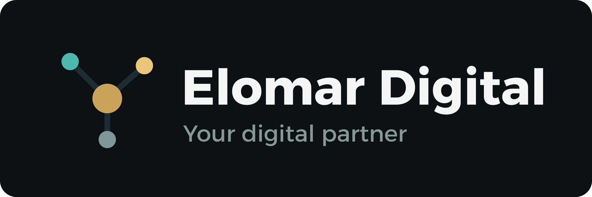

<p align="center">
  
</p>

<p align="center">
  <a href="https://elomardigital.com"></a>
  <a href="https://github.com/sponsors/abobasel86"></a>
  <a href="https://marketplace.visualstudio.com/items?itemName=abobasel86.elomar-lang"></a>
</p>

## Hi, I'm Ayman 👋

I'm the founder of **[Elomar Digital](https://elomardigital.com)**, where we design,
build and run digital systems for organizations, and the creator of
**[Elomar-Lang](https://github.com/abobasel86/elomar-lang)**: a simple, typed
programming language with AI built in, that you can learn and write in
**Arabic** or **English**.

```elomar
use std.ai

type Ticket = { category: String, urgent: Bool }

fn main() {
    let name = "Lina"
    print("Hello, {name}!")
    print([3, 1, 2].sorted().map(|x| x * 10))
}
```

### Elomar-Lang

| | |
|---|---|
| 📘 **Tutorial** | [Ten short lessons, in English and Arabic](https://abobasel86.github.io/elomar-lang/) |
| ▶️ **Playground** | [Run Elomar-Lang in your browser](https://abobasel86.github.io/elomar-lang/en/playground.html) |
| 🧩 **Editor** | [VS Code extension](https://marketplace.visualstudio.com/items?itemName=abobasel86.elomar-lang) with errors as you type, completion and a debugger |
| ⬇️ **Download** | [Latest release](https://github.com/abobasel86/elomar-lang/releases/latest) for Windows, Linux and macOS |

**Packages:**
[elomar-registry](https://github.com/abobasel86/elomar-registry) ·
[elomar-textkit](https://github.com/abobasel86/elomar-textkit) ·
[elomar-csvkit](https://github.com/abobasel86/elomar-csvkit) ·
[elomar-validator](https://github.com/abobasel86/elomar-validator)

### Support my work

Elomar-Lang is free and open source. If it is useful to you or your company,
you can support it through **[GitHub Sponsors](https://github.com/sponsors/abobasel86)**.

---

<div dir="rtl">

## مرحباً، أنا أيمن 👋

مؤسس **[Elomar Digital](https://elomardigital.com)**، شريكك الرقمي: نصمّم ونبني
ونشغّل الأنظمة الرقمية للمؤسسات.

وأعمل على **[Elomar-Lang](https://github.com/abobasel86/elomar-lang)**، لغة برمجة
بسيطة، فيها الذكاء الاصطناعي جزء من اللغة، ويمكنك أن تتعلمها وتكتب بها
**بالعربية** أو **بالإنجليزية**، من الكلمات المفتاحية إلى رسائل الأخطاء.

- 📘 [الدروس بالعربية](https://abobasel86.github.io/elomar-lang/ar/)
- ▶️ [جرّب اللغة في المتصفح](https://abobasel86.github.io/elomar-lang/ar/playground.html)
- 🧩 [إضافة VS Code](https://marketplace.visualstudio.com/items?itemName=abobasel86.elomar-lang)

اللغة مجانية ومفتوحة المصدر. إن كانت مفيدة لك أو لمؤسستك، يمكنك
[دعم تطويرها](https://github.com/sponsors/abobasel86) ♥

</div>
